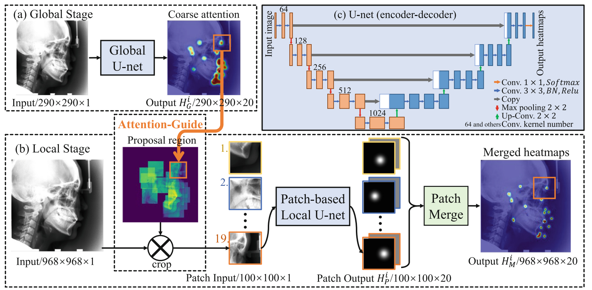
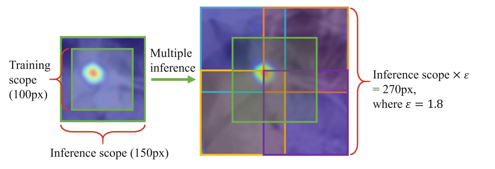

# Attention-Guided Cephalometric Landmark Detection

Research code for **An Attention-Guided Deep Regression Model for Landmark Detection in Cephalograms** (MICCAI 2019).

**Zhusi Zhong, Jie Li, Zhenxi Zhang, Zhicheng Jiao, Xinbo Gao**  
*Medical Image Computing and Computer Assisted Intervention - MICCAI 2019*, LNCS 11769, pp. 540-548.

[Paper / DOI](https://doi.org/10.1007/978-3-030-32226-7_60) | [arXiv](https://arxiv.org/abs/1906.07549) | [BibTeX](citation.bib) | [Pretrained weights](https://drive.google.com/file/d/17sb4rC5OnIgBBA6OrXzYg0wT-iOKzhdD/view?usp=sharing) | [Checkpoint inventory](docs/CHECKPOINTS.md)

The framework localizes **19 anatomical landmarks** in lateral cephalometric X-rays. Two separately trained U-Nets combine global anatomical configuration with high-resolution local appearance. Global heatmaps guide local patch selection through the **Attention-Guide** mechanism, while **Expansive Exploration** enlarges the local search region without adding network parameters.

The main implementation is in **[`refine_net/`](refine_net/)**, curated from the original `dental/refine_net` source. The companion global stage is in [`coarse_stage/`](coarse_stage/). Both active configurations use **UNet with one grayscale input channel and 20 output channels**: 19 landmarks plus background.

## Framework



*Figure 1 from Zhong et al., MICCAI 2019. The global U-Net predicts coarse heatmaps; their landmark locations guide local patch selection. A patch-based local U-Net refines heatmaps, which are merged to recover the final landmark locations.*

1. **Heatmap regression:** represent each of the 19 landmarks with a Gaussian heatmap and add a shared background channel.
2. **Global stage:** process the downscaled full image to learn global landmark configuration and estimate coarse locations.
3. **Attention-guided local stage:** crop high-resolution proposal patches around those coarse locations and regress local heatmaps with a second U-Net.
4. **Expansive Exploration:** sample overlapping patches over an expanded proposal region, merge their responses, and extract refined coordinates.

The two stages use a combination of binary cross-entropy and focal loss. Attention-Guide is implemented through coarse-coordinate-guided patch selection; it does not require an additional transformer attention layer.



*Figure 2 from the paper. The illustrated configuration uses a 100-pixel training patch, 150-pixel inference patches, and expansion factor 1.8. Four offset patches and one central patch enlarge the search scope.*

## Results reported in the paper

The following values are transcribed from **Table 1 of the published paper**. They are historical published results, not new measurements from this source release or its packaged checkpoints.

| Evaluation | MRE ± Std (mm) | SDR @ 2.0 mm | SDR @ 2.5 mm | SDR @ 3.0 mm | SDR @ 4.0 mm |
| --- | ---: | ---: | ---: | ---: | ---: |
| Test 1 | 1.12 ± 0.88 | 86.91% | 91.82% | 94.88% | 97.90% |
| Test 2 | 1.42 ± 0.84 | 76.00% | 82.90% | 88.74% | 94.32% |
| Four-fold cross-validation | 1.22 ± 2.45 | 86.06% | 90.84% | 94.04% | 97.28% |

The challenge split contains 150 training, 150 Test 1, and 100 Test 2 images. Challenge evaluation uses the average of two observers' annotations; the four-fold experiment uses the senior observer's annotations.

This repository retains historical experiment code. Some local heatmap, inference-patch, merging, and coordinate-extraction settings differ from the published protocol. See [paper-to-code notes](docs/PAPER.md) before attempting reproduction. In the selected refinement training source, checkpoint selection uses training loss; its validation-loss block remains disabled.

## Repository layout

```text
.
├── refine_net/                 # Main refinement implementation
│   ├── train.py                # Configurable training entry point; defaults to UNet
│   ├── predicte.py             # Original offline prediction/evaluation script
│   ├── model/                  # UNet and retained architecture variants
│   ├── dataset/                # Training and prediction patch datasets
│   ├── loss/                   # BCE-related focal and Dice utilities
│   ├── utils/                  # Heatmaps, cropping, coordinates, preprocessing
│   └── logger/                 # Logging and loss plots
├── coarse_stage/               # Companion coarse-localization research code
├── tools/
│   ├── prepare_refinement_data.py
│   └── check_release.py
├── docs/                       # Data format, checkpoints, and release notes
├── licenses/                   # Preserved third-party license texts
├── requirements.txt
└── THIRD_PARTY_NOTICES.md
```

## Environment

Use a dedicated Python environment. The refinement implementation retains CUDA-specific tensors and requires an NVIDIA GPU and a compatible PyTorch installation. CPU execution is available as an option in the coarse-stage training script only.

Install the PyTorch build appropriate for your system using the [official PyTorch installation page](https://pytorch.org/get-started/locally/), then install the remaining imports:

```bash
python -m venv .venv
# Activate .venv using the command appropriate for your shell.
python -m pip install -r requirements.txt
```

`requirements.txt` lists imports inferred from the source; it is **not a tested or pinned environment lockfile**. The cleanup was checked with Python 3.12, but GPU training and compatibility with a particular PyTorch/CUDA version have not been tested.

CRF postprocessing is optional and loaded only when requested. The old `coarse_stage/data_preprocess.py` also imports MXNet; that helper is not needed for the new refinement-data preparation command below.

## Prepare refinement data

Keep local datasets inside the ignored `data/` directory. For each split, provide image files and matching `<image-stem>.txt` annotations containing at least 19 lines of `x,y` coordinates. Supply an already chosen or averaged annotation set; the preparation tool does not merge multiple observers automatically.

For images that are already square and cropped:

```bash
python tools/prepare_refinement_data.py --images data/cropped/TrainData --annotations data/cropped/averaged_annotations --output data/scale0.5/TrainData --scale 0.5
python tools/prepare_refinement_data.py --images data/cropped/ValData --annotations data/cropped/averaged_annotations --output data/scale0.5/ValData --scale 0.5
```

For uncropped images, use an explicit crop box only when it matches your dataset. The original preprocessing used `(left=0, top=465, right=1935, bottom=2400)`:

```bash
python tools/prepare_refinement_data.py --images data/raw/TrainData --annotations data/raw/averaged_annotations --output data/scale0.5/TrainData --scale 0.5 --crop-box 0 465 1935 2400
```

The tool checks image sizes and annotation bounds, normalizes grayscale intensities to `[0,1]`, and writes NumPy arrays into a **new directory**. It never modifies the input images or annotations. See [the data-format guide](docs/DATA_FORMAT.md) for coordinate transforms and array shapes.

## Train the refinement UNet

Run commands from the repository root:

```bash
python refine_net/train.py --train-data data/scale0.5/TrainData --val-data data/scale0.5/ValData --checkpoint-dir checkpoints/refine_net --epochs 5000 --batch-size 10 --learning-rate 0.01
```

The default patch size is `100`, the random crop range is `0.5`, and all 19 landmarks are sampled. Runs are created as numbered subdirectories such as `checkpoints/refine_net/001/`. An existing run can be loaded with `--load 1`; this restores the model weights, not the optimizer state or a complete training session.

```bash
python refine_net/train.py --help
```

Alternative network classes remain in `refine_net/model/` for research reference. The active training configuration is UNet. Weights trained with a different architecture cannot be substituted without matching that architecture.

## Coarse stage and pretrained checkpoints

The coarse stage has a separate training entry point:

```bash
python coarse_stage/train.py --data-root data/Cephalometry_crop --checkpoint-dir checkpoints/stage1 --log-dir runs/stage1 --epochs 5000 --scale 0.15
```

Its expected image and text-annotation layout is documented in [DATA_FORMAT.md](docs/DATA_FORMAT.md). Use `--cpu` to explicitly select CPU execution.

The original project still contains **four folds of coarse and refinement checkpoints** under `dental_review/stage1_model` and `dental_review/stage2_model`. Each checkpoint is about 51 MiB. Their parameter names are consistent with UNet, but loading and prediction quality have not been validated during this cleanup. See [the checkpoint inventory and loading notes](docs/CHECKPOINTS.md).

**[Download pretrained UNet weights from Google Drive](https://drive.google.com/file/d/17sb4rC5OnIgBBA6OrXzYg0wT-iOKzhdD/view?usp=sharing)**

The separate archive, `dental-pretrained-unet.zip` (about 804 MiB), contains all 17 retained checkpoints for both stages and all four folds, together with a checkpoint inventory and per-file checksums. The linked Google Drive page is publicly accessible and displays the expected archive filename.

Expected SHA-256 of the archive:

```text
290dfb582f88f779c680c028c5f02e9035383b13d27847b4491adfdd88af3363
```

The checksum is also available in [`docs/weights-archive.sha256`](docs/weights-archive.sha256). Extract the archive into a local directory and follow [CHECKPOINTS.md](docs/CHECKPOINTS.md). Model binaries remain separate from the Git repository and are ignored by Git.

## Prediction and evaluation status

`refine_net/predicte.py` is the original offline experiment script. It retains experiment-specific paths, coarse-prediction inputs, split assumptions, and the original coordinate conversion. It is **not yet a general-purpose prediction CLI**. Configure these values for your own dataset before using it; do not assume its example paths refer to bundled data.

The original prediction dataset can center patches on ground-truth landmarks when no coarse labels are supplied. That mode is an oracle-centered experiment, not an end-to-end coarse-to-fine evaluation. Use independently generated coarse predictions for end-to-end evaluation and keep sample order and coordinate frames aligned.

The published results above have not been reproduced in this cleanup; no accuracy guarantee is made for the packaged checkpoints. The historical preprocessing scripts are retained for reference; some perform work when imported. Prefer the explicit preparation tool above for refinement arrays.

## Check the source release

```bash
python tools/check_release.py
```

This standard-library-only check validates Python syntax and rejects data, weights, caches, oversized files, and machine-specific path literals in a source publication. The GitHub workflow also checks the documented command-line help entry points. These checks do not execute GPU training or establish clinical performance.

See [RELEASE_NOTES.md](docs/RELEASE_NOTES.md) for the cleanup scope and validation record.

## Citation

If you use this code or the associated method in your research, please cite:

```bibtex
@inproceedings{zhong2019attention,
  author    = {Zhong, Zhusi and Li, Jie and Zhang, Zhenxi and Jiao, Zhicheng and Gao, Xinbo},
  title     = {An Attention-Guided Deep Regression Model for Landmark Detection in Cephalograms},
  booktitle = {Medical Image Computing and Computer Assisted Intervention -- MICCAI 2019},
  series    = {Lecture Notes in Computer Science},
  volume    = {11769},
  pages     = {540--548},
  year      = {2019},
  publisher = {Springer},
  address   = {Cham},
  doi       = {10.1007/978-3-030-32226-7_60},
  url       = {https://doi.org/10.1007/978-3-030-32226-7_60}
}
```

GitHub also exposes the paper through **Cite this repository**, using [`CITATION.cff`](CITATION.cff).

## Attribution and licensing

Existing upstream notices and license texts are preserved in [THIRD_PARTY_NOTICES.md](THIRD_PARTY_NOTICES.md) and `licenses/`. This cleanup does not assign a new blanket license to the original research code. The retained upstream licenses continue to apply to their corresponding portions. This source release contains no raw clinical image datasets, dataset archives, annotations, or model binaries. The README includes two attributed illustrations from the associated paper; see [figure provenance](docs/PAPER.md).
